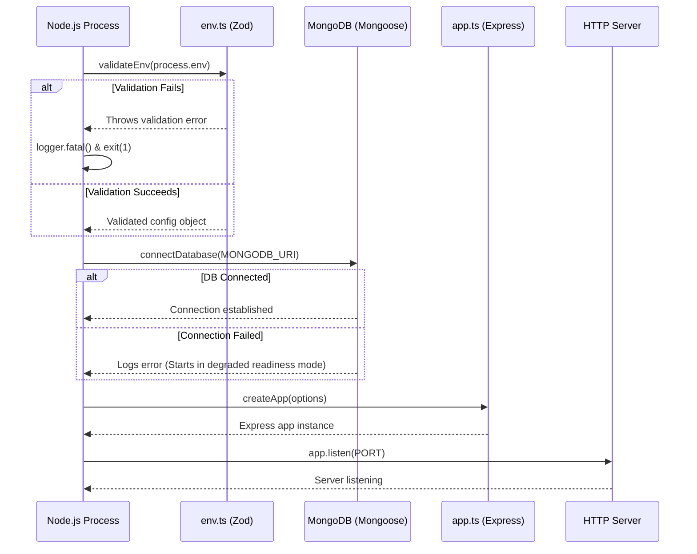
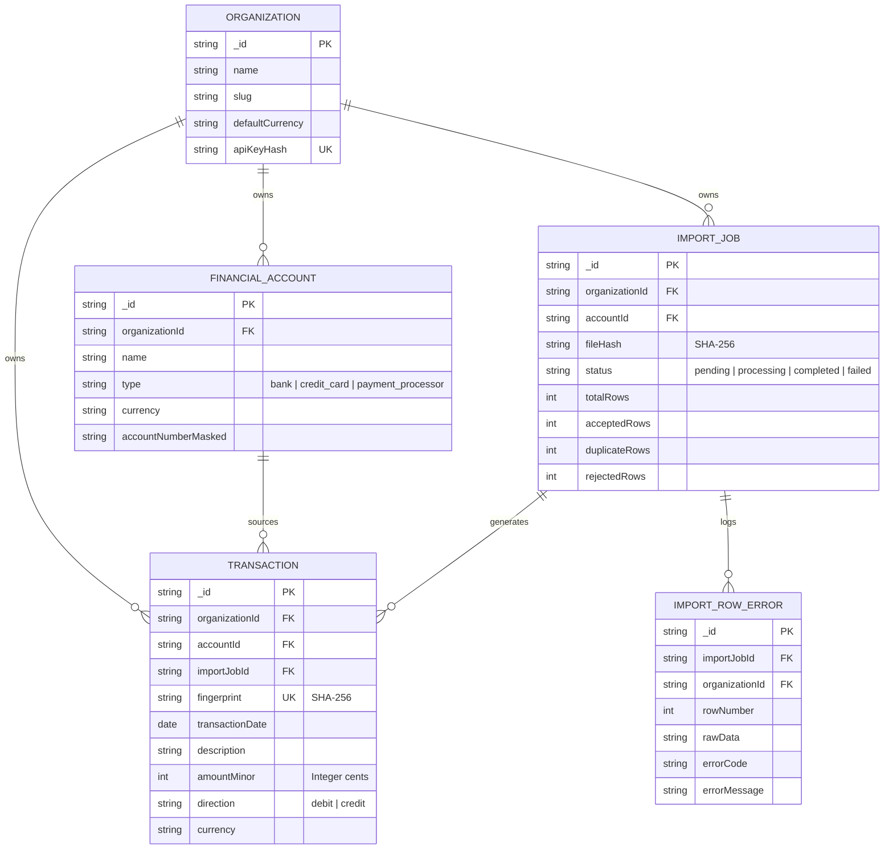
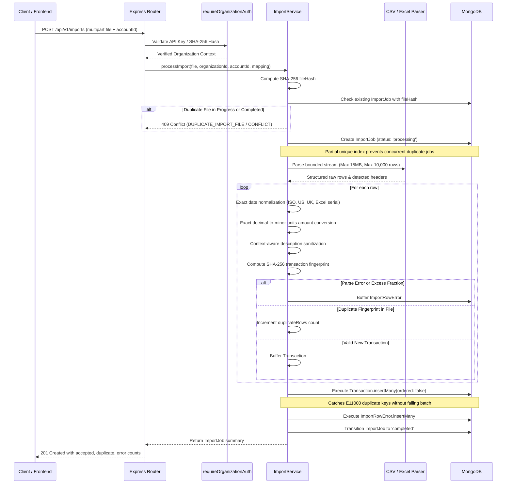
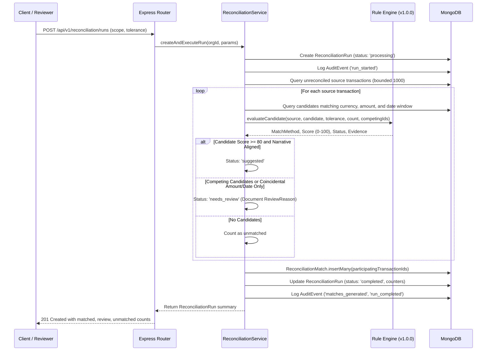
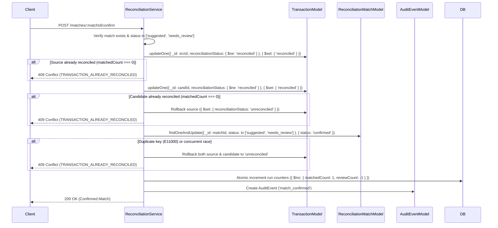

# MoneyLens — Architecture & Engineering Specification

This document details the architectural foundation, boundaries, design decisions, and runtime lifecycle for MoneyLens Phase 1.

---

## 1. System Overview

MoneyLens is an AI-powered financial intelligence and money leakage detection platform designed for small business owners, retail operators, finance managers, and accountants.

Phase 1 establishes a production-grade monorepo foundation with decoupled services, strict type safety, defensive HTTP controls, and automated testing.

---

## 2. Monorepo Structure

```
moneylens/
├── apps/
│   ├── api/                     # Backend Node.js / Express service
│   │   ├── src/
│   │   │   ├── config/          # Validated Zod environment parsing
│   │   │   ├── middleware/      # Request ID, rate limiting, centralized error handling
│   │   │   ├── infrastructure/  # MongoDB lifecycle & Pino structured logging
│   │   │   ├── routes/          # Express route definitions (/api/v1/health, /api/v1/ready)
│   │   │   ├── app.ts           # Express application constructor (independent of port binding)
│   │   │   └── server.ts        # Server entrypoint with lifecycle management & graceful exit
│   │   ├── test/                # Automated Vitest & Supertest suites
│   │   ├── package.json
│   │   └── tsconfig.json
│   │
│   └── web/                     # Frontend React + Vite application
│       ├── src/
│       │   ├── app/             # Application root (App.tsx) and React Router
│       │   ├── components/      # Reusable layout and status indicators
│       │   ├── lib/             # Validated client env and centralized API client
│       │   ├── services/        # Service layer communicating with API endpoints
│       │   ├── test/            # React Testing Library & Vitest suites
│       │   ├── index.css        # Tailwind CSS directives
│       │   └── main.tsx         # Application entry point with React Query provider
│       ├── package.json
│       ├── vite.config.ts
│       └── tsconfig.json
│
├── packages/
│   └── shared/                  # Reusable cross-boundary contracts and types
│       ├── src/
│       │   ├── contracts/       # Zod schemas for API responses
│       │   ├── types/           # Canonical TypeScript interfaces & error codes
│       │   └── index.ts         # Shared entrypoint
│       ├── package.json
│       └── tsconfig.json
│
├── docs/                        # Architecture & development documentation
├── package.json                 # Monorepo root workspace configuration
├── eslint.config.js             # Root ESLint v9 configuration
├── .prettierrc                  # Monorepo code style configuration
├── .gitignore                   # Monorepo ignore rules
├── .env.example                 # Documented environment template
└── README.md                    # Primary repository overview
```

---

## 3. Frontend / Backend Boundaries

| Domain               | Frontend (`apps/web`)                                                  | Backend (`apps/api`)                                                               | Shared (`packages/shared`)                                |
| :------------------- | :--------------------------------------------------------------------- | :--------------------------------------------------------------------------------- | :-------------------------------------------------------- |
| **Responsibilities** | User interface, layout, presentation, query caching, telemetry display | Business logic, authentication (future), data persistence, auditing, HTTP security | Data contracts, Zod schemas, API route paths, error codes |
| **Secrets**          | Strictly prohibited from containing credentials or server keys         | Environment variables validated at boot; secrets never logged or exposed           | Pure schemas and contracts only; zero secrets             |
| **Target Runtime**   | Modern evergreen browsers (ES2020+)                                    | Node.js v20+ runtime (ES2022 / NodeNext)                                           | Universal TypeScript                                      |

---

## 4. Startup & Graceful Shutdown Lifecycle

### Backend Startup Sequence (`server.ts`)



### Graceful Shutdown Sequence

When the process receives a termination signal (`SIGTERM` or `SIGINT`):

1. `server.close()` stops accepting new HTTP connections. Existing connections are allowed to complete.
2. `disconnectDatabase()` cleanly closes Mongoose database sockets.
3. A 10-second timeout safeguard triggers a forced exit if connections do not terminate cleanly.
4. Process exits with code `0`.

---

## 5. Configuration Strategy

- Environment variables are parsed and validated strictly using **Zod** prior to any infrastructure initialization.
- If a required variable is missing or malformed (such as an invalid `PORT` or improper `MONGODB_URI` scheme), the process halts immediately with descriptive error logging.
- `apps/web` accesses only Vite-prefixed variables (`VITE_API_URL`) validated via `validateClientEnv()`.

---

## 6. Health and Readiness Probe Architecture

Separating process liveness from infrastructure readiness prevents cascading outages and enables zero-downtime rolling deployments:

### Liveness Probe (`GET /api/v1/health`)

- **Objective**: Verifies that the Node.js/Express process is responsive.
- **Status Code**: `200 OK`
- **Response**:
  ```json
  {
    "status": "ok",
    "timestamp": "2026-10-21T05:09:11.323Z",
    "uptime": 80.68,
    "version": "0.1.0",
    "environment": "development"
  }
  ```

### Readiness Probe (`GET /api/v1/ready`)

- **Objective**: Verifies whether required external infrastructure (MongoDB) is available to handle operational traffic.
- **Healthy (`200 OK`)**:
  ```json
  {
    "status": "ready",
    "timestamp": "2026-10-21T05:09:23.573Z",
    "services": {
      "database": {
        "status": "up"
      }
    }
  }
  ```
- **Degraded (`503 Service Unavailable`)**:
  ```json
  {
    "status": "not_ready",
    "timestamp": "2026-10-21T05:10:00.000Z",
    "services": {
      "database": {
        "status": "down"
      }
    }
  }
  ```

---

## 7. Security & Observability

1. **Request Identification (`request-id.ts`)**:
   - Every HTTP transaction is stamped with an `X-Request-Id` header (either preserving valid incoming IDs or generating a UUIDv4).
   - The correlation ID is attached to all Pino logs and error responses.
2. **Security Headers (`helmet`)**:
   - Automatically applies standard security headers (`HSTS`, `X-Content-Type-Options: nosniff`, `X-Frame-Options: SAMEORIGIN`, `Referrer-Policy`).
3. **CORS Hardening**:
   - Limits cross-origin access strictly to explicit origins defined by `FRONTEND_URL` and permits standard and authentication headers (`x-api-key`, `Authorization`, `x-request-id`).
4. **Rate Limiting (`express-rate-limit`)**:
   - Caps requests per IP address with standard `RateLimit-*` headers to mitigate denial-of-service abuse.
5. **Centralized Error Handling (`error-handler.ts`)**:
   - Operational errors (`AppError`) return structured, client-friendly error objects.
   - Validation errors (`ZodError`) return HTTP 400 with field-specific guidance.
   - Unexpected server errors return generic HTTP 500 responses without exposing internal messages or stack traces.
6. **Structured Logging (`pino`)**:
   - High-performance JSON logging with automated redaction of sensitive fields (`password`, `token`, `secret`, `authorization`, `cookie`, `mongodbUri`).

---

## 8. Phase 2: Financial Domain Design & Ingestion Architecture

### 8.1 Core Financial Domain Models

All business data is strictly scoped by tenant organization (`organizationId`). The database layer employs Mongoose with explicit string UUID primary keys and compound indexing:



### 8.2 Exact Decimal Financial Precision & Multi-Currency Model

MoneyLens enforces strict, zero-binary-floating-point financial calculations across the entire ingestion and ledger pipeline:

- **Exact Decimal String Parsing**: Floating-point arithmetic (`parseFloat(value) * 100`) is strictly prohibited. Currency values are parsed using exact string splitting into whole and fractional substrings, padded/scaled using `BigInt`, and validated against `Number.MAX_SAFE_INTEGER`.
- **Supported Currency Precision**:
  - **Zero Decimals (Factor $10^0 = 1$)**: Japanese Yen (`JPY`).
  - **Two Decimals (Factor $10^2 = 100$)**: US Dollar (`USD`), Euro (`EUR`), British Pound (`GBP`), Canadian Dollar (`CAD`), Australian Dollar (`AUD`), Indian Rupee (`INR`), Swiss Franc (`CHF`), New Zealand Dollar (`NZD`), Singapore Dollar (`SGD`), Hong Kong Dollar (`HKD`).
  - **Three Decimals (Factor $10^3 = 1000$)**: Kuwaiti Dinar (`KWD`), Bahraini Dinar (`BHD`), Omani Rial (`OMR`).
- **Indian Rupee (INR) Support**: Seamlessly parses Indian numbering formats with `₹` currency symbols and lakh/crore comma grouping (e.g., `₹12,34,567.89`).
- **Strict Format Validation**:
  - Rejects excess fractional digits rather than silently rounding (e.g., `12.345` for a 2-decimal currency is rejected as `INVALID_ROW_DATA`).
  - Rejects scientific notation (`1e5`), multiple decimal separators, ambiguous locale formats, empty values, and non-numeric garbage.
  - Magnitudes are stored as positive `amountMinor` (minor units), with transaction direction stored separately as `debit` or `credit`.

### 8.3 Context-Aware Formula & Macro Injection Protection

Spreadsheet formula injection (CSV injection) vulnerabilities are mitigated through context-aware sanitization:

- Formula execution characters (`=`, `@`, `+`, `\t`, `\r`) are escaped with a leading single quote (`'`).
- Leading minus signs (`-`) followed immediately by alphabetic words or standard text (e.g., `- Monthly Service Fee`, `-35.00 Adjustment`) are recognized as valid financial descriptions and preserved without mutilation. Only malicious formula constructs or formula expressions (e.g., `-2+3*cmd|' /C calc'!A0`) are sanitized.
- Control characters (ASCII 0–31, except standard spaces) are stripped.
- Formula cells in Excel files are evaluated purely for cached calculated scalar values; underlying macros or formula strings are never executed.

### 8.4 Ingestion Pipeline & Normalization Workflow



### 8.5 Duplicate Protection & Idempotency Strategy

MoneyLens enforces multi-tenant duplicate protection at two distinct layers:

1. **File-Level Deduplication & Concurrency Protection**:
   - SHA-256 hash computed over the raw file buffer, scoped strictly to `organizationId`.
   - Backed by a MongoDB partial unique index on `{ organizationId: 1, fileHash: 1 }` with filter `{ status: { $in: ['completed', 'processing'] } }`.
   - Concurrent identical uploads are blocked at the database engine level (yielding `409 Conflict`), preventing race conditions.
   - Failed import jobs (`status: 'failed'`) release the partial unique index, allowing safe, immediate retries of corrected files.
2. **Transaction-Level Fingerprinting**:
   - Fingerprint formula:
     $$\text{fingerprint} = \text{SHA256}(\text{orgId} + "|" + \text{accId} + "|" + \text{date} + "|" + \text{amountMinor} + "|" + \text{direction} + "|" + \text{currency} + "|" + \text{description} + "|" + \text{reference})$$
   - Uniquely indexed at `{ organizationId: 1, fingerprint: 1 }`.
   - Batch insertion utilizes `ordered: false` with deliberate `E11000` catch blocks: duplicate rows are counted toward `duplicateRows` without causing uncontrolled 500 crashes or corrupting the job counters.

### 8.6 Multi-Tenant Isolation & Credential Security

- **Organization Scoping**: All financial resources (`accounts`, `import_jobs`, `transactions`, `import_row_errors`) are filtered strictly by authenticated `req.organization._id`. Client-supplied IDs in request bodies or query params are strictly ignored.
- **API Key Storage & Verification**:
  - API keys are hashed with SHA-256 (`apiKeyHash`) before storage and query lookup.
  - The development key (`ml_dev_org_test_key_phase2`) is strictly rejected when `NODE_ENV === 'production'`, preventing accidental deployment with test credentials.
  - Sensitive API keys in `x-api-key` headers are redacted from structured application logs (`[REDACTED]`).
- **Error Responses**: Return generic `404 Not Found` for cross-tenant resource lookups, completely preventing existence leakage.

### 8.7 Performance & Indexing Strategy

Production-grade compound indexes optimize all primary query and deduplication patterns:

- `accounts`: `{ organizationId: 1, name: 1 }` (unique compound index for tenant accounts)
- `transactions`: `{ organizationId: 1, fingerprint: 1 }` (unique compound index for transaction deduplication)
- `transactions`: `{ organizationId: 1, transactionDate: -1, _id: -1 }` (compound sorting index with stable tie-breaker)
- `transactions`: `{ importJobId: 1 }` (provenance lookup index)
- `import_jobs`: `{ organizationId: 1, fileHash: 1 }` (partial unique index for completed/processing imports)
- `import_jobs`: `{ organizationId: 1, createdAt: -1 }` (tenant import history sorting)
- `import_row_errors`: `{ organizationId: 1, importJobId: 1, rowNumber: 1 }` (scoped compound error retrieval)

### 8.8 Failure Recovery Guarantees

- **No Zombie Jobs**: Import processing is wrapped in a fail-safe lifecycle handler. Any unhandled exception during parsing, mapping, or insertion transitions the `ImportJob` status to `'failed'` and persists `errorMessage`, ensuring jobs never get stranded in `'processing'`.
- **Bounded Resource Limits**:
  - HTTP upload size bounded to 15MB at the Multer stream layer (`LIMIT_FILE_SIZE` returns `400 FILE_TOO_LARGE`).
  - Row limit strictly bounded to 10,000 rows.
  - Page size capped at 100 rows with stable pagination.

### 8.9 Ingestion Scope Boundaries & Non-Claims

Phase 2 and 2.1 established rigorous financial data integrity, security hardening, and idempotent statement ingestion.

---

## 9. Financial Reconciliation Engine & Integrity Hardening (Phase 3 & 3.1)

### 9.1 Overview & Architecture

Phase 3 and 3.1 implement a deterministic, multi-tenant financial reconciliation engine that compares imported transactions across accounts and statements within an authenticated organization. It identifies defensible matches, flags ambiguous candidates for human review, and maintains a durable, auditable decision history.



### 9.2 Reconciliation Domain Model

1. **Reconciliation Run (`ReconciliationRunModel`)**:
   - Encapsulates a scoped reconciliation execution for an organization.
   - Statuses: `'pending'`, `'processing'`, `'completed'`, `'completed_with_errors'`, `'failed'`.
   - Counters: `totalSourceTransactions`, `matchedCount`, `reviewCount`, `unmatchedCount`, `errorCount`.
   - Invariant: $\text{totalSourceTransactions} = \text{matchedCount} + \text{reviewCount} + \text{unmatchedCount}$.
   - Configuration: `dateToleranceDays` (default 3, range 0–30), `rulesVersion` (`v1.0.0`), `startDate`, `endDate`, `accountId`, `targetAccountId`.
2. **Reconciliation Match (`ReconciliationMatchModel`)**:
   - Captures candidate or confirmed relationship between records.
   - `participatingTransactionIds`: Array containing `[sourceTransactionId, candidateTransactionId]` (or single source ID).
   - Statuses:
     - `'suggested'`: High-confidence rule-generated candidate awaiting approval.
     - `'needs_review'`: Candidate requiring human attention (competing candidates, coincidental amount/date without narrative alignment).
     - `'confirmed'`: Human decision approving the match.
     - `'rejected'`: Human decision rejecting the match with mandatory `rejectionReason`.
   - Match Methods: `exact_reference`, `transfer_match`, `amount_date_reference`, `amount_date_description`, `manual`.
   - Detailed Evidence: Amount match, currency match, date difference in days, description similarity score, direction compatibility, competing candidate count, competing candidate IDs, and explanatory notes.
3. **Reconciliation Audit Event (`ReconciliationAuditEventModel`)**:
   - Append-only historical record of state changes: `run_started`, `matches_generated`, `match_confirmed`, `match_rejected`, `match_reversed`, `run_completed`, `run_failed`.

### 9.3 Deterministic Matching Rules & Ambiguity Handling (`v1.0.0`)

- **Rule 1 — Organization & Scope Validation**: Only transactions within the authenticated organization are compared. Self-matches (`source._id === candidate._id`) and already reconciled records (`reconciliationStatus === 'reconciled'`) are strictly excluded.
- **Rule 2 — Currency Compatibility**: Cross-currency candidates (e.g. USD vs INR) are rejected from direct amount matching. Foreign exchange conversion is not performed in Phase 3.
- **Rule 3 — Exact External Reference**: Matching normalized alphanumeric references provides strong evidence (+30 points) when amount, currency, and direction are compatible. Generic non-unique placeholders (`N/A`, `NONE`, `NULL`, `REF`, `UNKNOWN`, `000`, `VOID`) are stripped during normalization and never generate an `exact_reference` match.
- **Rule 4 — Exact Amount & Date Bounds**: Matches require exact equality in minor units (`amountDifferenceMinor === 0`). An exact amount and date match alone without external reference or narrative similarity is never auto-confirmed; it is assigned method `amount_date_description` and flagged as `'needs_review'`.
- **Rule 5 — Date Tolerance**: Configurable calendar day difference calculated in UTC (bounded $0 \le \text{tolerance} \le 30$ days). Invalid dates return `null` and are rejected.
- **Rule 6 — Narrative Alignment & Transfer Matching**: Opposite direction across distinct accounts is only classified as `transfer_match` when supported by transfer keywords ("transfer", "wire", "internal", "ach", "payout") or description token similarity $> 0.3$. Equal amounts with unrelated descriptions across accounts are flagged for manual review.
- **Rule 7 — Competing Candidate Ambiguity**: When multiple candidates match the source criteria, candidate scores are penalized, competing candidate IDs are recorded in `evidence.competingCandidateIds`, and the match is marked `'needs_review'`. Ties are broken deterministically by sorting on `candidate._id`.

### 9.4 Reciprocal Match & Concurrency Hardening (Audit A)

In a two-party financial reconciliation system, confirming $A \leftrightarrow B$ must strictly prohibit:

1. Reciprocal confirmations: attempting to confirm $B \leftrightarrow A$.
2. Conflicting cross-confirmations: attempting to confirm $A \leftrightarrow C$ or $B \leftrightarrow D$.

#### Limitation of Independent Uniqueness Indexes

Separate partial unique indexes on `{ organizationId: 1, sourceTransactionId: 1 }` and `{ organizationId: 1, candidateTransactionId: 1 }` only prevent duplicate sources as sources and candidates as candidates. They do not cross-reference roles: if $A$ is a confirmed source, it was not indexed under `candidateTransactionId`, allowing $B \leftrightarrow A$ or $D \leftrightarrow A$ to bypass the index.

#### The Multikey Compound Partial Unique Index

To eliminate this vulnerability at the database engine level, Phase 3.1 introduces a compound multikey partial unique index over an array of participating IDs:

```typescript
reconciliationMatchSchema.index(
  { organizationId: 1, participatingTransactionIds: 1 },
  {
    unique: true,
    partialFilterExpression: { status: 'confirmed' },
    name: 'org_participating_tx_confirmed_unique',
  },
);
```

In MongoDB, a unique multikey index ensures every distinct ID in `participatingTransactionIds` across all confirmed documents is globally unique within that organization. Any attempt to confirm a match containing $A$ or $B$ (in either role) triggers an immediate `E11000 Duplicate Key Error`.

### 9.5 Atomicity, Concurrency & Recovery Guarantees (Audit B)

#### Deployment Reality

Local development and standard single-node deployments run MongoDB as a standalone server (`repl: undefined`). In standalone mode, multi-document ACID transactions (`session.startTransaction()`) are unavailable.

#### Two-Phase Conditional Locking Protocol

To provide race-safe and recoverable confirmation workflows on both standalone and replica-set deployments, `ReconciliationService` implements an atomic conditional locking and compensation rollback sequence:



1. **Conditional Atomic State Lock**: Uses single-document atomic `updateOne` with `{ reconciliationStatus: { $ne: 'reconciled' } }`. If two requests race to reconcile the same transaction, exactly one succeeds; the second receives `matchedCount === 0` and fails immediately.
2. **Deterministic Compensation Rollback**: If the candidate lock or match transition fails, all previously acquired locks are rolled back to `'unreconciled'`, preventing orphaned locks or partially reconciled pairs.
3. **Run Counter Preservation**: When confirming a `'suggested'` match, `matchedCount` is preserved without double-counting (since it was already counted at run completion). When confirming a `'needs_review'` match, `reviewCount` decrements by 1 and `matchedCount` increments by 1.

### 9.6 Audit Trail & Tenant Isolation Guarantees (Audits E & F)

- **Tenant Scoping**: All reconciliation endpoints (`/runs`, `/runs/:runId`, `/runs/:runId/audit-trail`, `/matches`, `/matches/:matchId`, `/matches/:matchId/confirm`, `/matches/:matchId/reject`) require API key authentication and filter strictly by `req.organization.id`.
- **Existence Leakage Prevention**: Requesting another organization's run, match, or audit trail returns generic `404 Not Found`.
- **Append-Only Immutability**: The API exposes no `PUT`, `PATCH`, or `DELETE` endpoints for audit events. Events are written only upon verified state changes.
- **Audit Limitation Disclaimer**: While append-only at the application API layer, audit records are stored in MongoDB collections without write-once-read-many (WORM) hardware or cryptographic blockchain proofs; privileged database administrators with direct connection access could alter raw collection documents.

### 9.7 Frontend State Consistency & Conflict Handling (Audit H)

- **Per-Row Loading State**: Confirming and rejecting buttons maintain distinct per-row loading states (`confirmingMatchId`, `rejectingMatchId`) and disable sibling buttons to prevent rapid double-clicks.
- **409 Conflict Cache Invalidation**: Upon receiving an HTTP 409 Conflict (e.g. from a concurrent confirmation in another tab or worker), the frontend automatically invalidates TanStack Query caches (`reconciliation-matches`, `reconciliation-runs`, `transactions`), instantly replacing stale candidate buttons with the confirmed status.
- **Safe Currency & Date Display**: All financial values render their native ISO currency codes and integer minor-unit formatted decimal amounts without lossy floating-point operations.

### 9.8 Scope Boundaries & Non-Claims

Phase 3 and 3.1 establish a deterministic, race-safe, and recoverable financial reconciliation engine. The system does **not**:

- Claim accounting general ledger certification or external financial audit compliance.
- Perform automated AI fraud detection or unsupervised anomaly scoring (Phase 4).
- Speculatively convert foreign exchange rates without an authoritative FX oracle.
- Claim cryptographic tamper-proofing against root database administrators.

---

## 10. Phase 4 — Financial Leakage Detection & Explainable Intelligence

Phase 4 introduces a deterministic financial findings engine and explainable intelligence layer that translates reconciled and normalized ledger data into evidence-backed, actionable financial insights for business operators.

```
┌──────────────────────────────────────────────────────────────────────────────────────────────┐
│                                    Detection Orchestrator                                    │
│                 (Tenant-Isolated, Bounded Query, Idempotent Execution)                       │
└──────────────────────────────────────────────┬───────────────────────────────────────────────┘
                                               │
                                 ┌─────────────┴─────────────┐
                                 ▼                           ▼
                     Deterministic Rules Engine      Reconciliation State
                     ├── RULE_DUP_001                (Audits Orphaned Records,
                     ├── RULE_UNUSUAL_001             Stale Match Proposals,
                     ├── RULE_REC_001                 and Conflicting Pairs)
                     ├── RULE_REC_INC_001
                     ├── RULE_SUP_VAR_001
                     └── RULE_REC_INCONSISTENT_001
                                 │
                                 ▼
                     Deterministic Fingerprinting
                     SHA-256(org | rule | ver | type | cur | sorted[txIds] | disc)
                                 │
                                 ▼
                     Finding Lifecycle & Deduplication
                     ├── Unique Compound Index: { organizationId: 1, fingerprint: 1 }
                     ├── Preserves Human Decisions (Dismissals & Confirmations)
                     └── Append-Only Audit History (FindingHistoryModel)
                                 │
                                 ▼
                     Explainable Intelligence Layer
                     ├── IFinancialExplainer (Provider-Neutral Interface)
                     ├── Deterministic Explainer (Built-in Rule Evidence Synthesis)
                     └── Google Gemini Adapter (Privacy-Bounded, Schema-Validated Fallback)
```

### 10.1 Domain Models and Contracts

1. **FinancialFinding (`FinancialFindingModel`)**:
   - `id`: Stable UUID identifier.
   - `organizationId`: Multi-tenant boundary isolation.
   - `findingType`: Enumerated category (`potential_duplicate_payment`, `unusual_expense`, `recurring_expense`, `recurring_cost_increase`, `supplier_price_variance`, `reconciliation_inconsistency`).
   - `status`: Lifecycle state (`open`, `under_review`, `confirmed_issue`, `dismissed`, `resolved`). Strictly disallows unsupported claims such as `fraud_confirmed`.
   - `severity`: Deterministically computed (`low`, `medium`, `high`).
   - `title` & `summary`: Descriptive human-readable summaries.
   - `primaryTransactionIds` & `relatedTransactionIds`: Linked normalized ledger records.
   - `estimatedAmountMinor` & `currency`: Bounded financial exposure represented in integer minor units.
   - `ruleId` & `ruleVersion`: Exact rule provenance.
   - `fingerprint`: Unique hash preventing duplicate records across evaluation runs.
   - `dismissalReason` & `resolutionNotes`: Documented human review inputs.
   - `aiExplanation`: Cached, validated explainability payload.

2. **FindingHistory (`FindingHistoryModel`)**:
   - Append-only audit record tracking every lifecycle change, decision transition, re-evaluation, and explanation request.

3. **DetectionRun (`DetectionRunModel`)**:
   - Execution tracker storing start/completion timestamps, observation scopes, transactions evaluated, counts created/updated/unchanged, errors, and per-rule breakdown.

### 10.2 Detection Rule Catalog

| Rule ID                     | Version  | Category                     | Trigger Criteria & Thresholds                                                                                                                                                                                                                                  | Evidence Produced                                                                                         |
| :-------------------------- | :------- | :--------------------------- | :------------------------------------------------------------------------------------------------------------------------------------------------------------------------------------------------------------------------------------------------------------- | :-------------------------------------------------------------------------------------------------------- |
| `RULE_DUP_001`              | `v1.0.0` | Potential Duplicate Payment  | Same org, currency, debit amount; posted within 5 days; token similarity $\ge 0.60$ or matching non-placeholder external reference (`INV-...`). Excludes self-matches and normal recurring charges.                                                            | Participating Tx IDs, dates, amounts, days difference, matched reference/similarity score.                |
| `RULE_UNUSUAL_001`          | `v1.0.0` | Unusual Expense              | Same merchant/account; $\ge 4$ historical debit observations; current charge $\ge 2.5\times$ median baseline and absolute variance $\ge 2,000$ minor units ($20.00).                                                                                           | Historical observation count, baseline median, current amount, difference minor units, comparison window. |
| `RULE_REC_001`              | `v1.0.0` | Recurring Expense            | Same merchant/currency; $\ge 3$ occurrences; intervals clustering within weekly (6–8d), bi-weekly (13–16d), monthly (27–32d), or quarterly (85–95d) windows; amount variance $\le 10\%$. Potential exposure is zero (informational).                           | Interval days, cadence, observation count, transaction dates, typical charge amount.                      |
| `RULE_REC_INC_001`          | `v1.0.0` | Recurring Cost Increase      | Verified recurring series; baseline established from $\ge 3$ prior charges; newest charge exceeds baseline by $> 10\%$ and $> 500$ minor units ($5.00).                                                                                                        | Baseline median, new charge amount, absolute increase, percentage increase, historical dates.             |
| `RULE_SUP_VAR_001`          | `v1.0.0` | Supplier Price Variance      | Compares unit prices across matching product SKUs when itemized `rawSourceData` (SKU, unit_price, quantity) is present. **Conservative Data Quality Boundary**: If statement data lacks itemized SKU details, returns empty without fabricating data.          | Product SKU, baseline unit price, new unit price, variance percentage, source references.                 |
| `RULE_REC_INCONSISTENT_001` | `v1.0.0` | Reconciliation Inconsistency | Audits ledger integrity: flags orphaned reconciled transactions without confirmed match records (mitigating Phase 3.1 process termination risks), competing match proposals ($> 1$ suggestion for same source), and unreviewed suggestions older than 14 days. | Reconciliation status, match document IDs, age in days, competing candidate transaction IDs.              |

### 10.3 Deduplication & Idempotency Strategy

- **Fingerprint Construction**:
  $$\text{Fingerprint} = \text{SHA256}(\text{orgId} \parallel \text{ruleId} \parallel \text{ruleVersion} \parallel \text{findingType} \parallel \text{currency} \parallel \text{sort}(\text{txIds}) \parallel \text{discriminator})$$
- **Compound Unique Index**: `{ organizationId: 1, fingerprint: 1 }` guarantees database-level uniqueness across concurrent detection runs.
- **Decision Preservation**: If an existing finding is `'dismissed'` or `'confirmed_issue'`, re-evaluation preserves the user's decision, dismissal reason, and notes without reopening or overwriting.

### 10.4 Financial Exposure & Savings Semantics

MoneyLens enforces strict semantic boundaries on financial metrics:

- **Potential Exposure**: Unconfirmed monetary risk identified by deterministic rules (e.g. unverified duplicate payment or unreviewed cost increase).
- **Confirmed Exposure**: Financial discrepancy verified by human review (`status = 'confirmed_issue'`).
- **Realized Savings**: Cash recovered or preserved through active intervention (e.g. vendor refund or subscription cancellation). The system **never** claims realized savings automatically upon finding creation.
- **Strict Currency Segregation**: Exposure metrics are aggregated strictly by ISO currency code. No cross-currency conversions or blended sums are performed without an explicit oracle.

### 10.5 Explainable Intelligence Layer

1. **Provider-Neutral Interface (`IFinancialExplainer`)**: Decouples detection rules from LLM providers.
2. **Deterministic Explainer (`DeterministicExplainer`)**: Synthesizes human-readable explanations directly from rule evidence, baseline metrics, and recommended checks without external network dependencies (`provider: 'deterministic_rule_engine'`).
3. **Google Gemini Explainer (`GeminiExplainer`)**: Connects to the Gemini REST API when `GEMINI_API_KEY` is provisioned. Enforces:
   - Privacy redaction: Never transmits authentication tokens, database IDs, or cross-tenant data.
   - Strict Zod schema validation: Validates candidate JSON output against `aiExplanationSchema`.
   - Offline / Failure Graceful Degradation: Falls back transparently to the deterministic engine if the provider times out, returns HTTP errors, or is unconfigured.

### 10.6 Phase 4 Boundaries & Non-Claims

- Findings represent potential anomalies and financial leakage requiring human inspection; they are **never** labeled as fraud, theft, or regulatory non-compliance.
- Supplier price variance is restricted to records with explicit itemized SKU metadata; bank statement descriptions are not guessed into invoices.
- AI explanations cannot modify the ledger, confirm findings, or guarantee savings.

---

## 11. Phase 5 — Cash Flow Forecasting & Scenario Planning Engine

Phase 5 introduces a deterministic, explainable Cash Flow Forecasting and Scenario Planning Engine that enables small business operators to project future liquidity across multiple horizons (7, 30, 60, and 90 days), anticipate cash-flow pressure, model upcoming recurring obligations, and stress-test what-if hypothetical scenarios without altering ledger records.

```
┌──────────────────────────────────────────────────────────────────────────────────────────────┐
│                                Cash Flow Forecast Orchestrator                               │
│                         (Tenant-Scoped, Multi-Currency Segregated)                           │
└──────────────────────────────────────────────┬───────────────────────────────────────────────┘
                                               │
                                 ┌─────────────┴─────────────┐
                                 ▼                           ▼
                   Historical Run Rate Engine      Phase 4 Recurring Findings
                   ├── Bounded History Window      ├── RULE_REC_001 (Cadence)
                   ├── Outlier Trimming (>5x Med)  ├── RULE_REC_INC_001 (Supersedes)
                   └── Daily Equivalent Isolation  └── Excludes Dismissed Findings
                                 │                           │
                                 └─────────────┬─────────────┘
                                               ▼
                                  Deterministic Forecast Engine
                                  ├── Exact Integer Minor Units Arithmetic
                                  ├── Strict Currency Partitioning (No Blending)
                                  ├── Calendar-Mapped Daily Timeline Points
                                  └── Double-Counting Prevention
                                               │
                                 ┌─────────────┴─────────────┐
                                 ▼                           ▼
                     Cash Shortage Risk Engine    What-If Scenario Simulator
                     ├── no_balance_data          ├── Revenue Adjustments (±%)
                     ├── insufficient_data        ├── Expense Adjustments (±%)
                     ├── low_risk                 ├── Recurring Adjustments (Cancel/Mod)
                     ├── moderate_risk            ├── One-Time Cash Injections/Outflows
                     └── high_risk (Deficit)      └── Baseline Immutability Guarantee
                                               │
                                               ▼
                                 Explainability & Audit Metadata
                                 ├── Documented Assumptions & Exclusions
                                 ├── Input Window & Transaction Coverage
                                 └── Explicit Limitations & Disclaimers
```

### 11.1 Domain Models and Schemas

1. **ForecastRun (`ForecastRunModel`)**:
   - `id`: Stable UUID identifier.
   - `organizationId`: Multi-tenant boundary isolation.
   - `status`: Execution state (`pending`, `completed`, `failed`).
   - `horizonDays`: Horizon period in days (7, 30, 60, 90).
   - `methodology` & `methodologyVersion`: Reproducible algorithmic version (`deterministic-runrate`, `v1.0.0-deterministic`).
   - `historyWindowDays`: Historical lookback window analyzed (e.g. 90 days).
   - `transactionsEvaluated`: Count of historical transactions processed.
   - `currencies`: List of currencies evaluated in this run.
   - `warnings`: Explanatory operational warnings (e.g. data sparsity).
   - `startedAt` & `completedAt`: Execution timestamps.

2. **CashFlowForecast (`CashFlowForecastModel`)**:
   - `id`: Stable UUID identifier.
   - `organizationId` & `forecastRunId`: Scoping references.
   - `currency`: Supported ISO currency code (USD, EUR, GBP, INR, CAD).
   - `horizonDays`, `startDate`, `endDate`: Projection calendar boundaries.
   - `hasReliableOpeningBalance`: Strict boolean indicating verified starting bank balance presence.
   - `openingBalanceMinor`: Verified starting balance in integer minor units, or `null`.
   - `projectedInflowsMinor`, `projectedOutflowsMinor`, `expectedNetMovementMinor`: Exact integer minor unit aggregates.
   - `projectedClosingBalanceMinor`: Calculated closing cash, or `null` if opening balance is absent.
   - `lowestProjectedBalanceMinor` & `lowestBalanceDate`: Intraday liquidity trough identifier.
   - `riskLevel`: Deterministic risk classification (`no_balance_data`, `insufficient_data`, `low_risk`, `moderate_risk`, `high_risk`).
   - `riskReason`: Evidence-based rationale for the risk classification.
   - `dataQuality`: Input health rating (`high`, `adequate`, `sparse_history`, `insufficient_history`).
   - `historicalDailyAvgInflowMinor` & `historicalDailyAvgOutflowMinor`: Baseline non-recurring daily run rates.
   - `recurringOutflowsCount` & `recurringOutflowsTotalMinor`: Total obligations mapped from Phase 4 recurring findings.
   - `points`: Ordered daily projection points (`CashFlowProjectionPoint`).
   - `assumptions` & `limitations`: Explanatory transparency notes.

3. **CashFlowScenario (`CashFlowScenarioModel`)**:
   - `id`: Unique UUID.
   - `organizationId`: Tenant isolation key.
   - `name`: User-assigned scenario title.
   - `currency`: Target ISO currency code.
   - `horizonDays`: Projection horizon.
   - `assumptions`: Validated simulation variables (revenue change %, expense change %, recurring adjustments, one-time cash events).

### 11.2 Deterministic Forecasting Methodology & Mathematical Formulation

The engine avoids black-box ML models, employing transparent and reproducible financial run-rate calculations:

1. **Robust Daily Run Rates**:
   $$\text{Median}_{\text{credit}} = \text{median}(\{ \text{amountMinor} \mid \text{direction} = \text{credit} \})$$
   $$\text{NormalCredits} = \{ c \mid c \le 5 \times \text{Median}_{\text{credit}} \lor c \le 50000 \}$$
   $$\text{DailyInflowMinor} = \left\lfloor \frac{\sum \text{NormalCredits}}{\max(\text{effectiveDays}, 1)} \right\rceil$$

2. **Phase 4 Recurring Integration & Double-Counting Elimination**:
   - Active recurring findings (`RULE_REC_001` and `RULE_REC_INC_001`) are queried for the target currency.
   - If a merchant has both a base recurring finding and a cost-increase finding, the cost-increase finding supersedes the base finding, eliminating duplication.
   - Dismissed findings (`status = 'dismissed'`) are strictly excluded.
   - To prevent double-counting historical recurring transactions in the daily baseline, the daily equivalent of all scheduled recurring items is subtracted from total daily historical outflows:
     $$\text{RecurringDailyEquiv} = \sum_{r} \left\lfloor \frac{\text{amountMinor}_r}{\text{cadenceDays}_r} \right\rceil$$
     $$\text{DailyOutflowMinor} = \max(0, \text{TotalDailyOutflowMinor} - \text{RecurringDailyEquiv})$$

3. **Timeline Calendar Projection**:
   For each day $t \in [1, \text{horizonDays}]$:
   $$\text{Inflow}_t = \text{DailyInflowMinor}$$
   $$\text{Outflow}_t = \text{DailyOutflowMinor} + \sum \text{ScheduledRecurringDue}_t$$
   $$\text{Net}_t = \text{Inflow}_t - \text{Outflow}_t$$
   $$\text{Balance}_t = \text{Balance}_{t-1} + \text{Net}_t \quad (\text{only if } \text{hasReliableOpeningBalance} = \text{true})$$

### 11.3 Opening Balance Integrity & Solvency Policy

- **Ledger Ingestion Reality**: MoneyLens statements represent historical transactional entries, not continuous verified bank account balances.
- **Strict Integrity Guarantee**: If an opening bank balance is not explicitly provided with a verified effective timestamp:
  - `hasReliableOpeningBalance` is set to `false`.
  - `openingBalanceMinor`, `projectedClosingBalanceMinor`, and `estimatedBalanceMinor` are set to `null`.
  - The UI explicitly renders: **"Net Movement Only"** and tracks net cash flow trajectory.
  - The engine **never** invents an opening balance, and **never** classifies a business as insolvent or in deficit without a verified starting balance.

### 11.4 Cash Shortage Risk Classification Engine

The risk engine operates deterministically on evidence:

| Risk Classification | Criteria                                                                                                             | UI Badge & Indication                               |
| :------------------ | :------------------------------------------------------------------------------------------------------------------- | :-------------------------------------------------- |
| `insufficient_data` | Transaction history covers $< 14$ days or fewer than 5 transactions.                                                 | Gray badge: "Insufficient History for Projection"   |
| `no_balance_data`   | Valid transaction history exists, but verified opening balance was not provided.                                     | Sky Blue badge: "Net Movement Tracked (No Balance)" |
| `high_risk`         | Reliable opening balance exists, and projected closing or intraday balance $< 0$.                                    | Red badge: "High Risk / Projected Deficit"          |
| `moderate_risk`     | Reliable balance exists and drops below 20% opening buffer; OR net cash burn exceeds 50% of inflows with no balance. | Amber badge: "Cash Flow Pressure"                   |
| `low_risk`          | Positive projected net movement and liquid cash reserves maintained throughout horizon.                              | Emerald badge: "Low Risk / Positive Net"            |

### 11.5 What-If Scenario Planning & Stress Testing

1. **Simulation Variables**:
   - Revenue adjustment: bounded between $-100\%$ and $+500\%$.
   - Operating expenses adjustment: bounded between $-100\%$ and $+500\%$.
   - Recurring obligation cancellation or modifications.
   - One-time cash events (inflows or outflows on specified dates).
2. **Immutability & Safety Rules**:
   - Baseline ledger transactions, reconciliation records, and Phase 4 findings are **never** mutated by scenario simulation.
   - Side-by-side comparison displays baseline vs. simulated inflows, outflows, net cash flow, and deltas.
   - Ad-hoc simulation (`POST /api/v1/cash-flow/simulate`) computes results in-memory without requiring database entity creation.

### 11.6 Multi-Currency Isolation & Exact Arithmetic

- Monetary amounts are strictly stored and computed in integer minor units (e.g. cents, pence, paise).
- Currencies are strictly segregated (USD, EUR, GBP, INR, CAD).
- Arithmetic across different currencies is strictly forbidden; each forecast run produces separate, isolated forecast documents per currency.

### 11.7 Frontend Architecture & Visualization

- **Custom SVG Chart (`CashFlowChart`)**: Built with native SVG elements and zero external chart dependencies to eliminate Canvas/JSDOM issues and bundle bloat. Features interactive hover crosshair, floating tooltips, responsive `viewBox`, multi-view toggles (`Closing Balance`, `Net Movement`, `Daily In/Outflows`), and dashed scenario overlay comparison lines.
- **Interactive Simulator (`CashFlowDashboard`)**: Reactive sliders for revenue/expense changes, form controls for adding and removing one-time cash events, real-time delta summary cards, and an explainability accordion detailing assumptions and limitations.

### 11.8 Scope Boundaries & Non-Claims

- Forecasts are **financial decision-support estimates**, not guaranteed financial outcomes or audit certifications.
- Machine learning prediction models, automated credit scoring, and FX currency speculation are out of scope.
- Tax liabilities and depreciation are excluded unless explicitly represented in transaction statements.

---

## 12. Phase 6: Business Action Center & Decision Intelligence

### 12.1 Overview & Decision-Support Standard

The Business Action Center synthesizes validated financial leakage findings (Phase 4) and cash-flow projections (Phase 5) into concrete, prioritized, evidence-backed actions for small retail business owners.

```
+---------------------------------------------------------------------------------------------------+
|                                      MONEYLENS ENGINE CORE                                        |
|                                                                                                   |
|  [ Normalized Ledger ] -----> [ Reconciliation Engine ] -----> [ Financial Leakage Findings ]     |
|          |                                                               |                        |
|          v                                                               v                        |
|  [ Cash Flow Projections ]                                    [ Business Action Center ]          |
|          |                                                               ^                        |
|          +---------------------------------------------------------------+                        |
|                                                                                                   |
|                                                                                                   |
|  [ Recommendation Engine ] ---> Pure Rules (A-H) ---> Priority Scoring (0-100)                    |
|                                                  ---> Stable Fingerprinting (SHA-256)             |
|                                                  ---> Lifecycle State Machine & Audit Trail       |
+---------------------------------------------------------------------------------------------------+
```

**Core Product Principles**:

1. **Decision Support, Not Autonomous Controller**: Recommendations empower the retail business owner to take informed actions. MoneyLens **never** autonomously cancels subscriptions, initiates payments, contacts vendors, or modifies ledger records.
2. **Strict Financial Concept Separation**:
   - **Potential Exposure**: Gross monetary volume at risk or observed variance.
   - **Estimated Avoidable Cost**: Portion that could realistically be avoided (e.g. marginal increase on a subscription, not the full recurring cost).
   - **Confirmed Issue Amount**: Human-verified discrepancy.
   - **Projected Cash Flow Effect**: Net liquidity impact over horizon.
   - **Realized Savings**: Verified post-resolution recovery.
3. **No Fabricated Evidence**: When underlying SKU, unit-price, or opening balance data is absent, MoneyLens explicitly states the limitation or skips the recommendation rather than inventing artificial figures.

### 12.2 Action Domain Model & Schema

Each `BusinessAction` entity enforces:

- `id`: Unique UUID identifier.
- `organizationId`: Tenant isolation boundary.
- `actionType`: Strongly typed enumeration (`review_duplicate_payment`, `verify_unusual_expense`, `review_recurring_cost_increase`, `mitigate_cash_flow_pressure`, `resolve_reconciliation_inconsistency`, `complete_financial_data`, `review_recurring_expense`, `audit_supplier_price_variance`).
- `category`: Domain grouping (`cost_reduction`, `cash_preservation`, `data_integrity`, `vendor_management`).
- `title` & `explanation`: Clear title and non-sensationalized business explanation.
- `priority` & `priorityScore`: Priority level (`critical`, `high`, `medium`, `low`) and reproducible score (0–100).
- `severity`: Underlying severity (`critical`, `high`, `medium`, `low`).
- `status`: Lifecycle state (`open`, `in_progress`, `completed`, `dismissed`, `snoozed`, `superseded`).
- `evidence`: Structured source evidence payload with primary/related transaction IDs and finding references.
- `financialImpact`: Multi-factor monetary breakdown strictly isolated by currency.
- `evidenceQuality`: Confidence classification (`high`, `adequate`, `preliminary`).
- `recommendedSteps`: Ordered action checklist with descriptive guidance.
- `ruleId` & `ruleVersion`: Recommendation rule provenance.
- `fingerprint`: Deterministic SHA-256 hash preventing duplicate generation.
- `snoozedUntil`: Validated future deadline for deferred review.
- `completedAt` & `completionNotes`: User task completion metadata.
- `dismissedAt` & `dismissalReason`: Mandatory audit reason explaining dismissal.
- `createdAt`, `updatedAt`, `lastEvaluatedAt`: Append-only timestamps.

### 12.3 Action Lifecycle State Machine & Audit Trail

```
               +---------------------------------------------+
               |                                             |
               v                                             |
           [ OPEN ] <----------------------------------------+ (Reopen)
          /    |   \                                         |
         /     |    \                                        |
        v      |     v                                       |
[ IN_PROGRESS ]|   [ SNOOZED ] (Wakeup on expiry)            |
        |      |      |                                      |
        v      v      v                                      |
       [ COMPLETED ] [ DISMISSED ] (Mandatory Reason) -------+
               |             |
               +-------------+
                      |
                      v (Evidence disappear / invalidate)
               [ SUPERSEDED ] (Terminal)
```

**State Machine Rules**:

- `open` -> `in_progress`, `completed`, `dismissed`, `snoozed`, `superseded`
- `in_progress` -> `open`, `completed`, `dismissed`, `snoozed`, `superseded`
- `snoozed` -> `open`, `in_progress`, `completed`, `dismissed` (and automatic wakeup on re-evaluation if `snoozedUntil <= now`)
- `completed` -> `open` (reopened; completed does **not** assert financial money recovery)
- `dismissed` -> `open` (reopened; requires non-empty `dismissalReason` when moving to dismissed)
- `superseded` -> Terminal state (retained with historical audit log)

**Audit Trail (`ActionHistory`)**:
Every lifecycle transition is immutably recorded in the append-only `ActionHistory` collection with `actionId`, `organizationId`, `previousStatus`, `nextStatus`, `eventType`, `actorId`, `reason`, `notes`, `metadata`, and timestamp.

### 12.4 Deterministic Recommendation Rule Catalog

| Rule ID                          | Action Type                            | Category            | Evidence Required                                         | Trigger & Behavior                                                                                                                                          |
| :------------------------------- | :------------------------------------- | :------------------ | :-------------------------------------------------------- | :---------------------------------------------------------------------------------------------------------------------------------------------------------- |
| `RULE_ACT_DUP_001`               | `review_duplicate_payment`             | `cost_reduction`    | Active `potential_duplicate_payment` finding              | Recommends reviewing duplicate debits with matching reference/amount. Distinguishes suspected charge from confirmed loss. Avoids claiming fraud.            |
| `RULE_ACT_UNUSUAL_001`           | `verify_unusual_expense`               | `cost_reduction`    | Active `unusual_expense` finding                          | Compares observed transaction against historical median. Explains limited history when observations $< 6$. Never claims an unusual expense is an error.     |
| `RULE_ACT_REC_INC_001`           | `review_recurring_cost_increase`       | `cost_reduction`    | Active `recurring_cost_increase` finding                  | Shows baseline average and latest amount with exact monetary arithmetic. Only avoidable cost is the marginal hike, not the full recurring charge.           |
| `RULE_ACT_CF_PRESSURE_001`       | `mitigate_cash_flow_pressure`          | `cash_preservation` | Phase 5 forecast with risk or negative net                | If opening balance is absent, discusses projected net movement only. Never labels retail business insolvent solely from projections. Links forecast run ID. |
| `RULE_ACT_REC_INCONSISTENCY_001` | `resolve_reconciliation_inconsistency` | `data_integrity`    | Active `reconciliation_inconsistency` finding             | Identifies orphaned reconciliation statuses, unreviewed candidates, or conflicting associations. Never alters reconciliation state automatically.           |
| `RULE_ACT_MISSING_DATA_001`      | `complete_financial_data`              | `data_integrity`    | 0 ledger transactions OR forecast missing opening balance | Recommends concrete data ingestion or balance input. Avoids creating actions for trivial empty fields; surfaces only material gaps.                         |
| `RULE_ACT_REC_EXPENSE_001`       | `review_recurring_expense`             | `vendor_management` | Active `recurring_expense` finding                        | Recommends reviewing ongoing subscription utility. Deduplicated against `RULE_ACT_REC_INC_001` to prevent dual recommendations for the same vendor.         |
| `RULE_ACT_SUP_VAR_001`           | `audit_supplier_price_variance`        | `vendor_management` | Active `supplier_price_variance` finding with SKU         | Enforces presence of structured SKU and unit price evidence. Safely skips when itemized data is absent without inventing prices or savings.                 |

### 12.5 Priority & Impact Scoring Formula

The priority score ($0 \le S \le 100$) is calculated reproducibly using four transparent factors:

$$S = \text{Clamp}_{5}^{100} \Big( \text{SeverityBase} + \text{ExposurePoints} + \text{EvidenceQualityPoints} + \text{CategoryUrgency} \Big)$$

1. **Severity Base**:
   - `critical`: $50\text{ pts}$
   - `high`: $35\text{ pts}$
   - `medium`: $20\text{ pts}$
   - `low`: $10\text{ pts}$
2. **Financial Magnitude Points** (based on max exposure minor units):
   - $\ge \$1,000.00$ ($100,000\text{ minor}$): $+25\text{ pts}$
   - $\ge \$250.00$ ($25,000\text{ minor}$): $+15\text{ pts}$
   - $\ge \$50.00$ ($5,000\text{ minor}$): $+8\text{ pts}$
   - $> \$0.00$: $+3\text{ pts}$
   - $\$0.00$: $+0\text{ pts}$
3. **Evidence Quality Points**:
   - `high`: $+15\text{ pts}$
   - `adequate`: $+8\text{ pts}$
   - `preliminary`: $+0\text{ pts}$
4. **Category Urgency Points**:
   - `cash_preservation`: $+10\text{ pts}$
   - `cost_reduction`: $+5\text{ pts}$
   - `data_integrity`: $+5\text{ pts}$
   - `vendor_management`: $+2\text{ pts}$

**Thresholds**:

- $S \ge 75$: `critical`
- $55 \le S < 75$: `high`
- $35 \le S < 55$: `medium`
- $S < 35$: `low`

### 12.6 Stable Fingerprinting, Deduplication & Concurrency

A canonical SHA-256 fingerprint is generated for every action:

```
SHA-256( organizationId | ruleId | ruleVersion | actionType | currency | sortedSourceFindingIds | sourceForecastRunId | discriminator )
```

**Database Guarantee**:

- Compound unique index: `{ organizationId: 1, fingerprint: 1 }`
- Prevents duplicate action generation even under concurrent evaluation requests.
- When re-evaluating:
  - Existing `completed` or `dismissed` actions are retained (never silently reopened).
  - Existing `snoozed` actions automatically reopen if the snooze deadline has elapsed.
  - Existing `open` or `in_progress` actions refresh mutable evidence and scoring.
  - Actions whose source evidence disappeared become `superseded`.

### 12.7 Multi-Currency Segregation & Financial Concepts

- Actions with monetary values store and present amounts strictly in integer minor units with explicit currency tagging (USD, EUR, GBP, etc.).
- Multi-currency amounts are **never** combined or converted into arbitrary totals.
- Financial exposure dashboards aggregate metrics strictly by currency bucket (`byCurrency[currency]`).
- Potential exposure is strictly distinguished from confirmed avoidable savings.

### 12.8 Backend REST API & Tenant Isolation

All endpoints require `requireOrganizationAuth` and derive organization context strictly from server authentication:

| Method | Endpoint                               | Description                                                                                            |
| :----- | :------------------------------------- | :----------------------------------------------------------------------------------------------------- |
| `POST` | `/api/v1/actions/evaluate`             | Evaluates supported findings and forecasts; generates, updates, or supersedes actions.                 |
| `GET`  | `/api/v1/actions/summary`              | Retrieves executive counts and currency-segregated financial exposure.                                 |
| `GET`  | `/api/v1/actions`                      | Retrieves paginated actions (`page`, `limit`, `status`, `priority`, `category`, `currency`, `search`). |
| `GET`  | `/api/v1/actions/:actionId`            | Retrieves a single action with source evidence and recommended steps.                                  |
| `POST` | `/api/v1/actions/:actionId/transition` | Executes a validated lifecycle transition (`status`, `reason`, `notes`, `snoozedUntil`).               |
| `GET`  | `/api/v1/actions/:actionId/history`    | Retrieves the chronological audit trail for the action.                                                |

**Tenant Isolation**:

- Client-supplied organization IDs in request bodies are ignored.
- Accessing cross-tenant action IDs returns HTTP 404 (safe not-found pattern).

### 12.9 Database Indexing & Migration Considerations

Indexes defined on `BusinessAction` and `ActionHistory`:

1. `{ organizationId: 1, fingerprint: 1 }` (Unique constraint for idempotency)
2. `{ organizationId: 1, status: 1, priorityScore: -1 }` (Optimized for priority-ordered active queries)
3. `{ organizationId: 1, category: 1 }` (Category filtering)
4. `{ organizationId: 1, createdAt: -1 }` (Chronological sorting)
5. `{ organizationId: 1, actionId: 1, createdAt: -1 }` (Audit history retrieval)

### 12.10 Frontend Architecture & Workflows

Integrated as Tab 5 (`ActionCenterDashboard.tsx`) in the main application shell:

- **Executive Summary**: Real-time counter cards for Critical & High, Open Tasks, In Progress, Snoozed, Completed, and Dismissed, alongside currency-segregated exposure cards.
- **Filtering & Search**: Status, Priority, Category, and keyword search with bounded pagination.
- **Action Cards**: Displays priority score, category badge, monetary impact, and highlighted Step 1 action.
- **Detail View Modal**: Rich view showing explanation rationale, step-by-step checklist, formatted JSON evidence, and chronological audit trail.
- **Lifecycle Workflows**: Dedicated interactive modals for starting actions, completing with resolution notes, dismissing with mandatory non-empty reasons, and snoozing with duration selectors (1, 3, 7, 14, 30 days).

### 12.11 Non-Claims & Human Responsibility

Recommendations generated by the Business Action Center are **decision-support suggestions** intended to assist retail business owners and finance teams in managing operations. They do not guarantee financial recovery, audit certification, or tax compliance.

---

## 13. Phase 7: Cross-Phase Integration, Security & Reliability Audit Findings

### 13.1 Cross-Phase Architecture & End-to-End Data Flow

The MoneyLens architecture enforces a strict unidirectional financial data pipeline:

1. **Statement Ingestion & Normalization (Phase 2)**: Statements (CSV/XLSX) are validated, sanitized (formula injection prevention), and persisted into integer minor-unit transactions (`TransactionModel`) scoped strictly to `organizationId`.
2. **Financial Reconciliation Engine (Phase 3)**: Unreconciled transactions are matched via deterministic multi-tier scoring (exact reference, internal transfer, amount-date-description). Confirmed matches atomically lock participating transactions via partial unique indexes.
3. **Financial Leakage Detection & Intelligence (Phase 4)**: Bounded detection runs evaluate rule pipelines (duplicate payments, unusual expenses, recurring charges, price increases, supplier variances, reconciliation inconsistencies) generating immutable fingerprints.
4. **Cash Flow Forecasting & Scenario Planning (Phase 5)**: Forecast runs compute deterministic daily projections and risk assessments based on historical run-rates and detected recurring charges without altering ledger transactions. Scenarios simulate stress without ledger mutation.
5. **Business Action Center (Phase 6)**: Recommendation rules evaluate active findings and forecast risks to produce prioritized, evidence-backed actions with compound unique deduplication and append-only audit histories.

### 13.2 Verified Defects, Severities, & Applied Remediations

| ID         | Severity | Category                  | Affected File(s)                                                                                                            | Defect Summary & Root Cause                                                                                                                                                  | Applied Remediation & Verification                                                                                                                                         |
| ---------- | -------- | ------------------------- | --------------------------------------------------------------------------------------------------------------------------- | ---------------------------------------------------------------------------------------------------------------------------------------------------------------------------- | -------------------------------------------------------------------------------------------------------------------------------------------------------------------------- |
| **DEF-01** | High     | Financial Correctness     | `supplier-price-variance.rule.ts`                                                                                           | Line item parsing used `parseFloat(unitPriceStr) * 100`, introducing floating-point precision hazards and failing on non-2-decimal currencies.                               | Replaced with `parseInputToMinorUnits(unitPriceStr, currency)` respecting ISO-4217 minor-unit decimals. Tested in `cross-phase.integration.test.ts`.                       |
| **DEF-02** | Medium   | Security / ReDoS          | `action.service.ts`                                                                                                         | Search term in `getActions()` passed raw user input to `$regex` without escaping or length boundaries, allowing ReDoS and regex injection.                                   | Truncated input to 100 characters and escaped regex meta-characters (`/[.*+?^${}()                                                                                         | [\\]\\\\]/g`). Tested in `action.api.test.ts` & integration suite. |
| **DEF-03** | Medium   | Reliability / Querying    | `action.service.ts`                                                                                                         | Query sorting by `potentialExposureMinor` attempted to sort on root field instead of nested `financialImpact.potentialExposureMinor`.                                        | Added field translation mapping `potentialExposureMinor` to `financialImpact.potentialExposureMinor`.                                                                      |
| **DEF-04** | Medium   | Financial Correctness     | `financial.contract.ts`, `CashFlowDashboard.tsx`, `CashFlowChart.tsx`, `ActionCenterDashboard.tsx`, `FindingsDashboard.tsx` | Frontend parsing and formatting assumed standard 2-decimal USD, risking rounding and display errors for zero-decimal (`JPY`) and 3-decimal currencies (`KWD`, `BHD`, `OMR`). | Exported centralized `formatCurrencyAmount` and `parseInputToMinorUnits` in shared contract. Applied across all dashboard cards, charts, and tables. Tested in `apps/web`. |
| **DEF-05** | High     | Reliability / Concurrency | `action.service.ts`, `finding.service.ts`                                                                                   | Concurrent evaluation requests triggered unhandled MongoDB `E11000 duplicate key error` on unique fingerprint indexes, returning HTTP 500.                                   | Implemented graceful catch and deduplication for `E11000` errors in action and finding persistence. Tested via 5-thread concurrent execution in Scenario 7.                |

### 13.3 Tenant Isolation Verification

All 6 core modules enforce strict multi-tenant isolation:

- **Authentication Boundary**: `requireOrganizationAuth` validates `x-api-key`, hashes tokens using SHA-256, and binds the authenticated `organizationId` directly to `req.organization`.
- **Query Scoping**: Every database read and write (`find`, `findById`, `findOne`, `deleteMany`, `countDocuments`, `aggregate`) mandates `{ organizationId }`.
- **IDOR Defense**: Passing IDs of resources belonging to another organization (imports, matches, findings, actions, history) yields deterministic `404 NOT_FOUND` responses without data leakage. Verified in Scenario 8 across all entities.

### 13.4 Financial Calculation Safety & Currency Boundaries

- **Integer Minor-Unit Standard**: All monetary values are strictly represented as integers in minor units (e.g., $100.00 = `10000`, 100 JPY = `100`, 1.500 KWD = `1500`).
- **No Floating-Point Arithmetic**: Sums, variances, net movements, and aggregations use integer arithmetic. Conversions between string inputs and minor units use exact string parsing (`parseInputToMinorUnits`).
- **Currency Boundaries**: Projections, findings, and actions strictly isolate transactions by currency. Cross-currency arithmetic is disallowed without explicit conversion models.
- **Truth in Balances**: When opening balances are absent, closing balances and solvency are not fabricated; only deterministic net cash movement is projected.

### 13.5 Database Consistency & Crash Recovery Limitations

- **MongoDB Standalone vs Replica Set**: In standalone deployments lacking multi-document ACID transactions, multi-step operations rely on atomic single-document updates, unique constraints, and compensating operations.
- **Transaction Locking**: Reconciliation prevents conflicting matches using MongoDB partial unique indexes (`org_source_tx_confirmed_unique`, `org_candidate_tx_confirmed_unique`, `org_participating_tx_confirmed_unique`).
- **Idempotency & Re-runs**: Finding detection runs and action evaluations utilize deterministic SHA-256 fingerprints. Repeated executions are fully idempotent and preserve human review states (`dismissed`, `confirmed_issue`, `resolved`, `completed`, `snoozed`).

### 13.6 Security Posture & Operational Limitations

- **Credential Hygiene**: API keys are hashed with SHA-256 (`apiKeyHash`). Plaintext credentials and environment variables are strictly redacted in logs.
- **Formula Injection Prevention**: Spreadsheet cells starting with `=`, `+`, `-`, or `@` are sanitized before ingestion.
- **Rate Limiting**: IP and token rate limiters protect public endpoints from brute-force attempts.
- **Release Blockers for Production**:
  1. Configure SSL/TLS termination and production CORS origins before public exposure.
  2. Implement database replica sets to enable native multi-document ACID transactions.
  3. Ensure distributed lock management (e.g., Redis) if horizontally scaling background detection workers.
